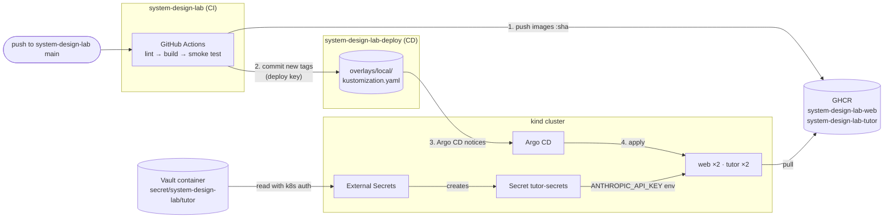

# system-design-lab-deploy

The **CD** half of [System Design Lab](https://github.com/Lutch21/system-design-lab). This repo
holds no application code, only what should be running in the cluster. Argo CD watches it and
makes the cluster match.

> **Support engineers:** start with [README_DEPLOYMENT.md](README_DEPLOYMENT.md). It's a full
> walkthrough of the Argo CD apps, image tags, the Vault secret flow, runbooks and troubleshooting.

| Repo | Job | Who changes it |
|---|---|---|
| [system-design-lab](https://github.com/Lutch21/system-design-lab) | **CI**: code, tests, Dockerfiles. Builds and pushes images. | Developers |
| **system-design-lab-deploy** (this one) | **CD**: Kubernetes manifests and Argo CD apps. | CI (image tags) and people (everything else) |

Why two repos:
- **Deploy history is easy to read.** `git log` here shows only deployments and config changes,
  not every code commit.
- **Rollback is a revert.** To roll back, revert CI's "Deploy …" commit. The code history isn't touched.
- **Less access is needed.** CI can write image tags here but has no access to the cluster.
  Argo CD reads this repo but never needs the code.

## How a change reaches the cluster



## Layout

```
argocd/
  root.yaml                     "App of apps": the only file applied by hand
  apps/
    external-secrets.yaml       External Secrets Operator (Helm chart 2.14.0, pinned)
    system-design-lab.yaml      The app → apps/system-design-lab/overlays/local
apps/system-design-lab/
  base/                         Same in every environment
    web.yaml                    Nginx + built React app; forwards /api to the tutor
    tutor.yaml                  Node tutor API; key from Secret tutor-secrets
    secrets.yaml                ExternalSecret + the vault-reader service account
  overlays/local/               The local kind cluster
    kustomization.yaml          Namespace + image tags (CI edits these)
    secret-store.yaml           Where Vault is and how to sign in
bootstrap/
  vault-kubernetes-auth.sh      One-time: let Vault trust this cluster's service accounts
```

**Base and overlays** (Kustomize): `base/` holds what's the same in every environment.
`overlays/local/` adds what's specific to one cluster: the namespace, the image tags, and where
Vault is. A `prod` overlay would reuse the same base with its own tags, replica counts and secret store.

## The API key: Vault → Kubernetes Secret → environment variable

The key never appears in Git, in CI or in a manifest.

1. The key lives in Vault at `secret/system-design-lab/tutor`, put there with
   `npm run vault:put-key` in the app repo.
2. External Secrets signs in to Vault as the `vault-reader` service account (Vault's Kubernetes
   auth method). Vault checks the account's token with the cluster, then issues a read-only
   token that lasts one hour.
3. External Secrets writes the value into the Kubernetes Secret `tutor-secrets`, and checks
   Vault again every hour.
4. The tutor Deployment maps that Secret to `ANTHROPIC_API_KEY`. Its code doesn't know Vault exists.

Things to know:
- A Kubernetes Secret is only base64-encoded, not encrypted. Limit who can read Secrets in the
  namespace (RBAC), and in production turn on encryption at rest for etcd (KMS on EKS).
- Environment variables are read once at startup. After rotating the key, either wait for the
  hourly refresh or force one, then restart the tutor:
  ```bash
  kubectl -n system-design-lab annotate externalsecret tutor-secrets force-sync=$(date +%s) --overwrite
  kubectl -n system-design-lab rollout restart deploy/tutor
  ```
  ([Reloader](https://github.com/stakater/Reloader) can restart pods automatically when a Secret changes.)

## First-time setup (local kind cluster)

Prerequisites: the kind cluster and Argo CD from devops-demo, and Vault running from the app
repo (`npm run vault:start`, plus `npm run vault:put-key` once).

```bash
# 1. Let Vault trust the cluster (once; safe to re-run)
sh bootstrap/vault-kubernetes-auth.sh

# 2. Hand everything else to Argo CD
kubectl apply -f argocd/root.yaml

# 3. Watch it come up
kubectl -n argocd get applications
kubectl -n system-design-lab get externalsecret,secret,pods

# 4. Open the app
kubectl -n system-design-lab port-forward svc/web 8081:80
# → http://localhost:8081
```

After Docker Desktop restarts, run `npm run vault:start` in the app repo. It unseals Vault and
reconnects it to the kind network.

## Day to day

| I want to… | Do this |
|---|---|
| Deploy new code | Push to `main` in system-design-lab. CI updates the tags here and Argo CD deploys. |
| Roll back | `git revert` CI's "Deploy …" commit here and push. |
| Change replicas, resources, config | Edit the YAML here and push. |
| See what's running | `kubectl -n argocd get applications`, or the Argo CD UI (`kubectl -n argocd port-forward svc/argocd-server 8443:443`) |
| Rotate the API key | `npm run vault:put-key` in the app repo, then the two commands above. |

## Troubleshooting

| Symptom | Check |
|---|---|
| `ExternalSecret` shows `SecretSyncedError` | `kubectl -n system-design-lab describe externalsecret tutor-secrets`. Usually Vault is sealed or stopped (`npm run vault:start`), or the bootstrap script hasn't run. |
| tutor pods stuck in `CreateContainerConfigError` | The Secret doesn't exist yet. Fix the ExternalSecret first; the pods start once it appears. |
| `ImagePullBackOff` with tag `not-built-yet` | CI hasn't completed a run on main yet. |
| The tutor says "no valid API key" | The key in Vault is wrong or was revoked. Update it, force a sync, then restart the tutor. |
