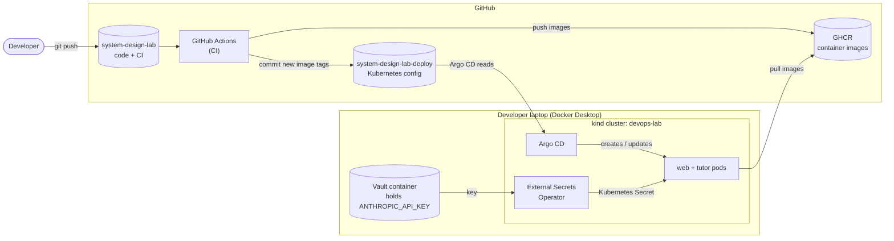
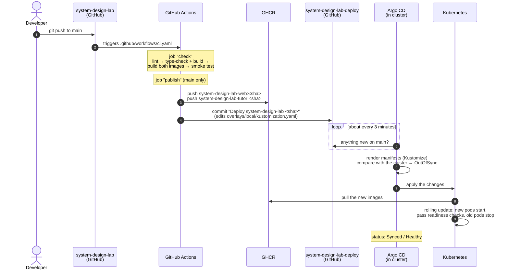
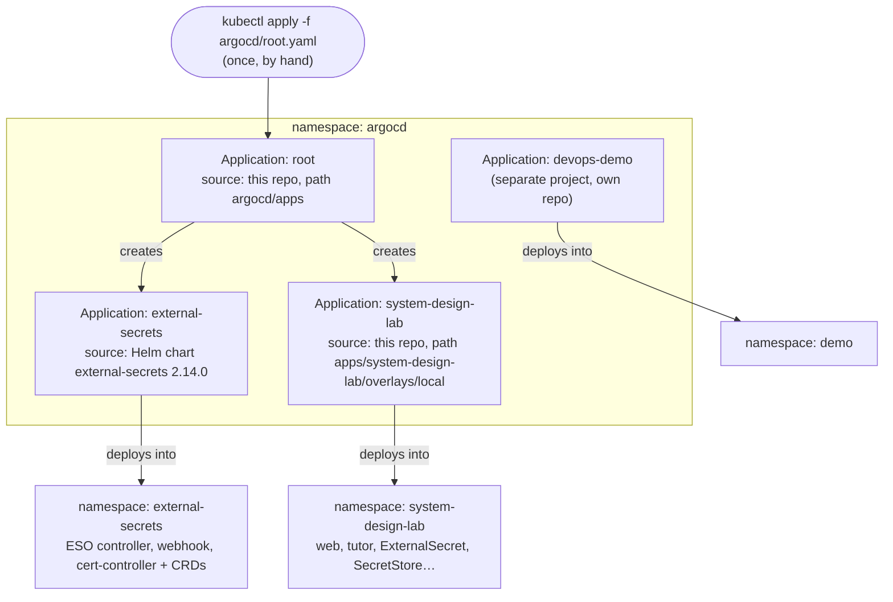
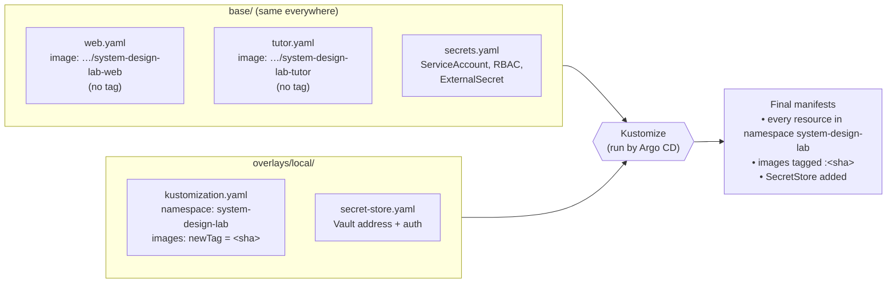
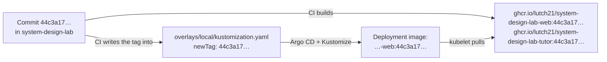
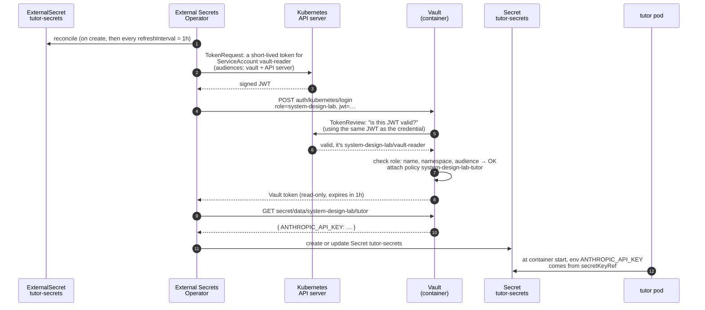
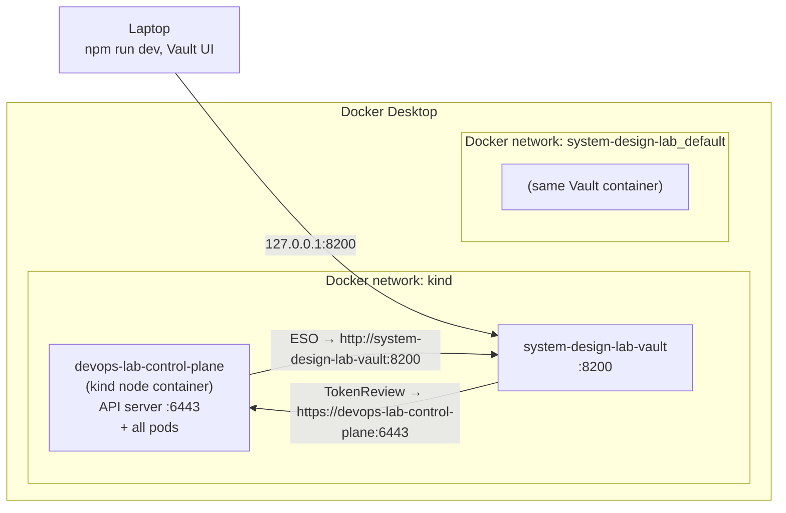
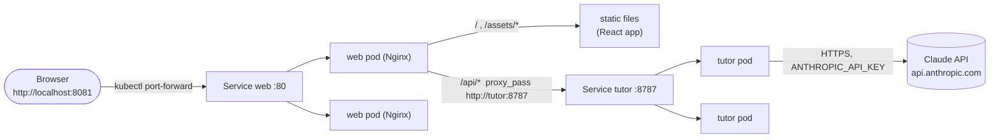

# System Design Lab: how the deployment works

This guide is for support engineers. It explains what runs where, how a code change reaches the
cluster, where image versions and secrets come from, and how to diagnose the usual problems.

It assumes you know basic Kubernetes (pods, deployments, services, secrets) and can run `kubectl`.
Everything else is explained here.

---

## Contents

1. [The big picture](#1-the-big-picture)
2. [The two repositories](#2-the-two-repositories)
3. [From code change to running pod](#3-from-code-change-to-running-pod)
4. [What Argo CD manages](#4-what-argo-cd-manages)
5. [How the manifests are assembled (Kustomize)](#5-how-the-manifests-are-assembled-kustomize)
6. [Where the image versions come from](#6-where-the-image-versions-come-from)
7. [How the API key gets from Vault into the pod](#7-how-the-api-key-gets-from-vault-into-the-pod)
8. [What runs in the cluster and how a request flows](#8-what-runs-in-the-cluster-and-how-a-request-flows)
9. [Reference: every name in one place](#9-reference-every-name-in-one-place)
10. [Runbooks](#10-runbooks)
11. [Troubleshooting](#11-troubleshooting)
12. [Known limits of this local setup](#12-known-limits-of-this-local-setup)

---

## 1. The big picture

System Design Lab has two services:

- **web**: the React app, built into static files and served by Nginx.
- **tutor**: a small Node.js API that calls the Claude API and needs an `ANTHROPIC_API_KEY`.

They run in a local Kubernetes cluster ([kind](https://kind.sigs.k8s.io/)) and are deployed with
**GitOps**: nobody runs `kubectl apply` to deploy. Instead, the desired state is written in a
Git repo, and **Argo CD**, running inside the cluster, keeps the cluster matching that repo.



The ideas behind it:

| Idea | What it means here |
|---|---|
| **Git is the source of truth** | What runs in the cluster is exactly what's in `system-design-lab-deploy` on `main`. To change what runs, change Git. |
| **CI and CD are separate** | CI (GitHub Actions) builds and tests images. CD (Argo CD) deploys them. CI never touches the cluster. |
| **Secrets never go in Git** | The API key lives in Vault. Git only says *where* to find it. |

---

## 2. The two repositories

| | **system-design-lab** (CI) | **system-design-lab-deploy** (CD, this repo) |
|---|---|---|
| URL | https://github.com/Lutch21/system-design-lab | https://github.com/Lutch21/system-design-lab-deploy |
| Contains | App code, Dockerfiles, `nginx.conf`, smoke test, CI workflow, local Vault setup | Kubernetes manifests, Argo CD Applications, Vault bootstrap script |
| Who changes it | Developers | CI (image tags only) and engineers (everything else) |
| What reads it | GitHub Actions | Argo CD |
| Its `git log` shows | Code history | **Deployment history**: every deploy, rollback and config change |

Why two repos? Deploy history stays readable. A rollback is a `git revert` that doesn't touch
code history. And each system gets only the access it needs: CI can write image tags here but
has no cluster access, and Argo CD reads this repo but never needs the code.

### Layout of this repo

```
system-design-lab-deploy/
├── argocd/
│   ├── root.yaml                       ← "app of apps": the ONLY file ever applied by hand
│   └── apps/
│       ├── external-secrets.yaml       ← installs External Secrets Operator (Helm chart)
│       └── system-design-lab.yaml      ← deploys the app from apps/…/overlays/local
├── apps/system-design-lab/
│   ├── base/                           ← the same in every environment
│   │   ├── kustomization.yaml
│   │   ├── web.yaml                    ← Deployment + Service "web"
│   │   ├── tutor.yaml                  ← Deployment + Service "tutor"
│   │   └── secrets.yaml                ← ServiceAccount, RBAC, ExternalSecret
│   └── overlays/local/                 ← specific to the local kind cluster
│       ├── kustomization.yaml          ← namespace + IMAGE TAGS (CI edits this file)
│       └── secret-store.yaml           ← where Vault is and how to sign in
└── bootstrap/
    └── vault-kubernetes-auth.sh        ← one-time: make Vault trust this cluster
```

---

## 3. From code change to running pod



Details worth knowing:

- **Image tag = full Git commit SHA** of the app repo, for example `44c3a177…`. Any running pod can
  be traced back to the exact code it was built from.
- **The CI job "check"** runs on every push and pull request. **"publish"** runs only on `main`.
- **Smoke test** ([`scripts/smoke-test.sh`](https://github.com/Lutch21/system-design-lab/blob/main/scripts/smoke-test.sh)):
  starts both images together and checks that the page loads, that `/api` reaches the tutor, and
  that the tutor reports a missing key properly. It needs no secret.
- **Images are built for two CPU types**, `linux/amd64` and `linux/arm64`, so they run on Intel
  servers and on kind on Apple Silicon Macs.
- **Protection against an old build:** if `main` moved on while CI was running, CI skips the
  deploy commit, so an outdated image can't overwrite a newer one.
- **How CI writes to this repo:** with an SSH **deploy key**. The private half is stored as the
  secret `DEPLOY_REPO_KEY` in the app repo, and the public half is a deploy key with write access
  on this repo only. (The built-in `GITHUB_TOKEN` can only write to its own repo.)
- **How Argo CD notices:** it checks the repo about every 3 minutes (no webhook in this local
  setup). To make it check now, see [Runbooks](#10-runbooks).

---

## 4. What Argo CD manages

### What an Argo CD "Application" is

An **Application** is a Kubernetes resource (it lives in the `argocd` namespace) that tells
Argo CD three things:
1. **source**: which repo, branch and folder, or which Helm chart, to read.
2. **destination**: which cluster and namespace to deploy into.
3. **syncPolicy**: whether to apply changes automatically, and what to do about drift.

### App of apps

Instead of applying each Application by hand, a single **root** Application points at the
`argocd/apps/` folder, which contains the other Applications. Argo CD then manages
Applications as well as the app.



To add a component to the cluster, add an Application file to `argocd/apps/` and push. To
remove one, delete the file and push. `prune: true` on root deletes the Application.

### The three Applications

| Application | Source | Destination namespace | Notable settings |
|---|---|---|---|
| **root** | this repo → `argocd/apps` | `argocd` | Automated sync, prune, self-heal |
| **external-secrets** | Helm repo `https://charts.external-secrets.io`, chart `external-secrets`, version **2.14.0** (pinned) | `external-secrets` | `installCRDs: true`; `ServerSideApply=true` because the CRDs are too large for a normal apply; `CreateNamespace=true` |
| **system-design-lab** | this repo → `apps/system-design-lab/overlays/local` | `system-design-lab` | `CreateNamespace=true`; **retry** (up to 10 times, backoff up to 3 min), so a brand-new cluster can sync before ESO's CRDs exist |

All three use:
- **`automated`**: changes in Git are applied without anyone clicking "Sync".
- **`prune: true`**: anything deleted from Git is deleted from the cluster.
- **`selfHeal: true`**: if someone changes a resource by hand with `kubectl edit` or `scale`,
  Argo CD changes it back to what Git says. **Manual changes don't stick: change Git instead.**

Argo CD renders Helm charts itself, so Helm doesn't need to be installed on anyone's machine.

### Sync and health status

| Status | Meaning |
|---|---|
| **Synced** | The cluster matches Git. |
| **OutOfSync** | Git and the cluster differ. With automated sync this is usually brief, while Argo CD applies the change. |
| **Healthy** | Every resource is working: Deployments have their ready pods, and so on. |
| **Progressing** | A rollout is under way, or pods aren't ready yet. |
| **Degraded** | Something is failing, for example pods crash-looping or images that can't be pulled. |

---

## 5. How the manifests are assembled (Kustomize)

Argo CD doesn't apply the YAML files one by one. It runs **Kustomize** on the overlay folder,
which combines `base/` with the overlay's changes into one final set of manifests.



**Why split it this way?** Anything that would differ between environments goes in the overlay:
the namespace, the image tags, and where Vault is. A future `overlays/prod/` would reuse the
same `base/` with its own tags, replica counts and secret store.

**To see exactly what Argo CD will apply**, run this from the repo root:
```bash
kubectl kustomize apps/system-design-lab/overlays/local
```

---

## 6. Where the image versions come from

There's **one** place that decides which version runs:
`apps/system-design-lab/overlays/local/kustomization.yaml`

```yaml
images:
  - name: ghcr.io/lutch21/system-design-lab-web
    newTag: 44c3a17737814f00cdd62b993d07effc612c05d8   # ← commit SHA in the app repo
  - name: ghcr.io/lutch21/system-design-lab-tutor
    newTag: 44c3a17737814f00cdd62b993d07effc612c05d8
```



- **Registry:** GitHub Container Registry (GHCR). The packages are **public**, so the cluster
  pulls them without credentials and no `imagePullSecret` is needed.
- **Both images get the same tag**, because they're built from the same commit.
- **Deploy a specific version** by changing `newTag` to that commit's SHA and pushing.
- **Roll back** with `git revert` on the "Deploy …" commit, then push.

**Which version is running right now?**
```bash
kubectl -n system-design-lab get deploy -o custom-columns=NAME:.metadata.name,IMAGE:.spec.template.spec.containers[0].image
```
Then look the SHA up at `https://github.com/Lutch21/system-design-lab/commit/<sha>`.

---

## 7. How the API key gets from Vault into the pod

This is the part with the most moving pieces. In short: **Vault holds the key → External Secrets
copies it into a Kubernetes Secret → the tutor reads that Secret as an environment variable.**
The key never appears in Git, CI logs or manifests.

### 7.1 The pieces

| Piece | Where | Role |
|---|---|---|
| **Vault** | Docker container `system-design-lab-vault` on the laptop, outside the cluster | Stores the key at `secret/system-design-lab/tutor`, field `ANTHROPIC_API_KEY` |
| **External Secrets Operator (ESO)** | Namespace `external-secrets` | A controller that signs in to Vault, reads secrets and writes Kubernetes Secrets |
| **SecretStore `vault`** | Namespace `system-design-lab` (from the overlay) | Tells ESO where Vault is and how to sign in |
| **ExternalSecret `tutor-secrets`** | Namespace `system-design-lab` (from base) | Tells ESO what to copy and which Secret to create |
| **ServiceAccount `vault-reader`** | Namespace `system-design-lab` | The identity ESO uses to sign in to Vault. Nothing else uses it. |
| **ClusterRoleBinding `system-design-lab-vault-reader-tokenreview`** | Cluster-wide | Gives `vault-reader` the built-in `system:auth-delegator` role, so its token can call the TokenReview API (see 7.3) |
| **Secret `tutor-secrets`** | Namespace `system-design-lab` | Created and owned by ESO. Holds `ANTHROPIC_API_KEY`. |
| **Deployment `tutor`** | Namespace `system-design-lab` | Maps the Secret to the `ANTHROPIC_API_KEY` environment variable |

### 7.2 The flow



### 7.3 Vault configuration

This is set up once by `bootstrap/vault-kubernetes-auth.sh` (this repo) and `scripts/vault.sh`
(app repo).

| Vault object | Value | Why |
|---|---|---|
| Secrets engine | **KV version 2** mounted at `secret/` | Key/value store that keeps versions. In the API, data paths gain a `data/` segment: `secret/data/system-design-lab/tutor`. |
| Secret | `secret/system-design-lab/tutor` → `ANTHROPIC_API_KEY` | The tutor's API key |
| Policy | `system-design-lab-tutor`: `read` on `secret/data/system-design-lab/tutor` only | Least privilege: it can't list, write or read anything else |
| Auth method | `kubernetes` at `auth/kubernetes` | Lets workloads in the cluster sign in with their service-account token |
| Auth config | `kubernetes_host = https://devops-lab-control-plane:6443`, plus the cluster's CA certificate | Where Vault sends TokenReview calls, and which certificate it trusts |
| Role | `system-design-lab`: service account `vault-reader`, namespace `system-design-lab`, audience `vault`, policy `system-design-lab-tutor`, TTL `1h` | Only this one account, in this one namespace, can sign in, and it gets read-only access |

**Why the token has two audiences.** A service-account token says which systems it's meant for
(its *audience*). The SecretStore asks for two:
- **`vault`**, because the Vault role only accepts tokens meant for Vault. A token issued for some
  other system can't be replayed here.
- **`https://kubernetes.default.svc.cluster.local`** (the API server's audience). No separate
  reviewer token is configured, so Vault uses the same token as its credential when it calls
  TokenReview, and the API server rejects tokens that weren't issued for it. **Without this
  audience, login fails with `403 permission denied`.**

### 7.4 How the cluster reaches Vault

Vault runs in Docker Desktop, outside the cluster. kind's node is also a Docker container, on a
Docker network called `kind`. Attaching the Vault container to that network lets both sides
reach each other by container name:



- The Vault container is defined in the **app repo's** `docker-compose.yml`. Its data is on the
  Docker volume `system-design-lab_vault-data`.
- `npm run vault:start` (app repo) starts it, unseals it, and reconnects it to the `kind` network.
  Docker forgets that network link whenever the container is recreated.
- Vault starts **sealed** after every restart: it can't read its own data until it's unsealed.
  The unseal key and root token are in the app repo's `.vault/init.json`, which is git-ignored.

### 7.5 What the tutor pod sees

```yaml
env:
  - name: ANTHROPIC_API_KEY
    valueFrom:
      secretKeyRef:
        name: tutor-secrets
        key: ANTHROPIC_API_KEY
```

The tutor code has no Kubernetes or Vault logic. On startup it logs `API key source: environment`.
(When a developer runs it locally with `npm run dev`, it reads Vault directly and logs
`API key source: Vault`.)

Environment variables are read **once, when the container starts**. A new value in the Secret
doesn't reach running pods until they restart (see [Runbooks](#10-runbooks)).

---

## 8. What runs in the cluster and how a request flows

### 8.1 Resources in namespace `system-design-lab`

| Kind | Name | Details |
|---|---|---|
| Deployment | `web` | 2 replicas · `nginx:1.28-alpine` + built app · port 80 · readiness `GET /` · no service-account token mounted |
| Service | `web` | ClusterIP, port 80 → pods `app=web` |
| Deployment | `tutor` | 2 replicas · Node 24 · port 8787 · readiness and liveness `GET /api/health` · runs as UID 1000 (non-root), read-only root filesystem, all Linux capabilities dropped, no service-account token mounted |
| Service | `tutor` | ClusterIP, port 8787 → pods `app=tutor` |
| ServiceAccount | `vault-reader` | Used only by ESO to sign in to Vault |
| ExternalSecret | `tutor-secrets` | Vault → Secret, refreshed every 1h |
| SecretStore | `vault` | Vault address and Kubernetes auth settings |
| Secret | `tutor-secrets` | Created by ESO; don't edit it by hand |

Plus one cluster-wide **ClusterRoleBinding**, `system-design-lab-vault-reader-tokenreview`.

### 8.2 A user request

There's no Ingress in this local cluster, so you reach the app with `kubectl port-forward`.
The web pods' Nginx serves the page and forwards `/api/*` to the tutor Service, so the browser
only ever talks to one address.



The Nginx settings that matter for `/api` are in `nginx.conf` in the app repo:
- `proxy_buffering off`: the tutor streams its answer, and this passes words through as they arrive.
- `proxy_read_timeout 300s`: long answers can take a while.

The tutor endpoints:
- `GET /api/health` returns `{"ok":true,"model":"…"}` and is used by the probes.
- `POST /api/tutor` streams the answer.

---

## 9. Reference: every name in one place

| Thing | Value |
|---|---|
| Cluster | kind cluster `devops-lab`, kubectl context `kind-devops-lab`, node `devops-lab-control-plane` |
| Argo CD | namespace `argocd`; Applications `root`, `external-secrets`, `system-design-lab` |
| App namespace | `system-design-lab` |
| ESO | namespace `external-secrets`, Helm chart `external-secrets` **2.14.0**, CRD API version `external-secrets.io/v1` |
| Images | `ghcr.io/lutch21/system-design-lab-web:<sha>`, `ghcr.io/lutch21/system-design-lab-tutor:<sha>` |
| Image tags set in | `apps/system-design-lab/overlays/local/kustomization.yaml` |
| CI workflow | `system-design-lab/.github/workflows/ci.yaml` |
| CI → deploy repo credential | Secret `DEPLOY_REPO_KEY` (app repo) ↔ write deploy key (this repo) |
| Vault container | `system-design-lab-vault`, image `hashicorp/vault:1.21.2`, `http://127.0.0.1:8200` from the laptop, `http://system-design-lab-vault:8200` from the cluster |
| Vault secret | `secret/system-design-lab/tutor` → `ANTHROPIC_API_KEY` |
| Vault policy / role | `system-design-lab-tutor` / `system-design-lab` (auth method `kubernetes`) |
| Vault unseal key and root token | app repo `.vault/init.json` (git-ignored, keep it safe) |
| Kubernetes Secret | `tutor-secrets` in `system-design-lab` |

---

## 10. Runbooks

### Open the app
```bash
kubectl -n system-design-lab port-forward svc/web 8081:80
# → http://localhost:8081
```

### Open the Argo CD UI
```bash
kubectl -n argocd get secret argocd-initial-admin-secret -o jsonpath="{.data.password}" | base64 -d; echo
kubectl -n argocd port-forward svc/argocd-server 8443:443
# → https://localhost:8443   user: admin
```

### Check overall health
```bash
kubectl -n argocd get applications
kubectl -n system-design-lab get pods,externalsecret,secretstore
```

### Make Argo CD check Git now (instead of waiting about 3 minutes)
```bash
kubectl -n argocd annotate application system-design-lab argocd.argoproj.io/refresh=hard --overwrite
```

### Deploy a specific version or roll back
```bash
# in this repo
git log --oneline -- apps/system-design-lab/overlays/local/kustomization.yaml   # deploy history
git revert <deploy-commit>    # roll back to the previous version
git push                      # Argo CD applies it
```

### Rotate the API key
```bash
# 1. In the app repo: store the new key in Vault (prompts; input is hidden)
npm run vault:put-key
# 2. Make ESO copy it now instead of waiting up to 1h
kubectl -n system-design-lab annotate externalsecret tutor-secrets force-sync=$(date +%s) --overwrite
# 3. Restart the tutor so it reads the new value
kubectl -n system-design-lab rollout restart deploy/tutor
```

### After a laptop or Docker Desktop restart
```bash
# In the app repo: start Vault, unseal it, reconnect it to the kind network
npm run vault:start
```
ESO picks this up on its own the next time it retries.

### Rebuild from scratch on a new kind cluster
Prerequisites: kind cluster with Argo CD installed (see devops-demo), Vault running with the key
stored (`npm run vault:start`, then `npm run vault:put-key` in the app repo).
```bash
sh bootstrap/vault-kubernetes-auth.sh   # make Vault trust the new cluster (CA and API address change)
kubectl apply -f argocd/root.yaml       # everything else follows from Git
```

---

## 11. Troubleshooting

Start with `kubectl -n argocd get applications`, then work through the table.

| Symptom | Likely cause | How to check / fix |
|---|---|---|
| Pods `ImagePullBackOff` / `ErrImagePull` | The tag doesn't exist in GHCR (CI didn't finish, or a typo in `newTag`) | `kubectl -n system-design-lab describe pod <pod>` shows the image. Check the CI run in the app repo's Actions tab. |
| Tutor pods `CreateContainerConfigError` | Secret `tutor-secrets` doesn't exist yet | Fix the ExternalSecret first (next rows). The pods start once the Secret appears. |
| ExternalSecret `SecretSyncedError`, SecretStore `InvalidProviderConfig` | ESO can't sign in to Vault or read the secret | `kubectl -n external-secrets logs deploy/external-secrets \| grep -i error`, then see the next rows. |
| ESO log: `connection refused` / `no such host system-design-lab-vault` | Vault is stopped, or not on the `kind` network | `npm run vault:start` in the app repo. Check with `docker inspect system-design-lab-vault -f '{{json .NetworkSettings.Networks}}'`. |
| ESO log: `Vault is sealed` / HTTP 503 | Vault restarted and wasn't unsealed | `npm run vault:start` |
| ESO log: `auth/kubernetes/login … 403 permission denied` | Vault rejected the login: wrong role or namespace, missing API-server audience, or a new cluster with an old CA | Re-run `sh bootstrap/vault-kubernetes-auth.sh`. Check `secret-store.yaml` still lists both audiences. |
| ESO log: `secret not found` / 404 | The key isn't stored in Vault | `npm run vault:status` in the app repo, then `npm run vault:put-key` |
| Tutor replies "The tutor has no valid API key" | The key is wrong or revoked, or pods started with an old value | Rotate the key (see Runbooks) and restart the tutor. |
| App shows **OutOfSync** for a long time | A resource can't be applied | Look at the Argo CD UI, or `kubectl -n argocd get application system-design-lab -o jsonpath='{.status.operationState.message}'` |
| Someone's `kubectl edit` or `scale` keeps getting undone | `selfHeal: true`, working as designed | Make the change in Git instead. |
| CI "publish" fails at "Bump image tags": `Permission denied` / 403 | `DEPLOY_REPO_KEY` secret or deploy key missing, or the key is read-only | Check the app repo's secrets and this repo's deploy keys (it needs **write** access). |
| `/api` returns 502 from Nginx | No ready tutor pods | `kubectl -n system-design-lab get pods -l app=tutor`, then check the tutor's logs. |

Useful commands:
```bash
kubectl -n system-design-lab logs -l app=tutor --prefix --tail=50     # tutor logs
kubectl -n system-design-lab describe externalsecret tutor-secrets    # sync status and events
kubectl -n external-secrets logs deploy/external-secrets --tail=50    # ESO controller logs
docker logs system-design-lab-vault --tail=50                         # Vault server logs
```

> Never print the Secret's value while debugging. To confirm it matches Vault, compare
> fingerprints instead:
> `kubectl -n system-design-lab get secret tutor-secrets -o jsonpath='{.data.ANTHROPIC_API_KEY}' | base64 -d | shasum`

---

## 12. Known limits of this local setup

This is a learning environment. In production you'd change the following:

| Local | Production |
|---|---|
| Vault in one container, one unseal key, plain HTTP | A highly available Vault cluster with TLS, auto-unseal (for example AWS KMS) and split unseal keys. Or AWS Secrets Manager: ESO supports both, and only the SecretStore changes. |
| A Kubernetes Secret is only base64-encoded | Turn on etcd encryption at rest (KMS on EKS) and limit `get secrets` with RBAC. |
| Tutor restarted by hand after a key rotation | [Reloader](https://github.com/stakater/Reloader) restarts pods automatically when a Secret changes. |
| Argo CD checks Git about every 3 minutes | A GitHub webhook to Argo CD for near-instant syncs. |
| Port-forward to reach the app | An Ingress (or AWS ALB) with a hostname and TLS. |
| One `local` overlay; CI deploys straight to it | `dev` / `staging` / `prod` overlays. CI updates dev, and moving a version to prod is a reviewed pull request in this repo. |
| Public repos and images | Private repos (Argo CD repo credentials) and private images (`imagePullSecrets`). |
